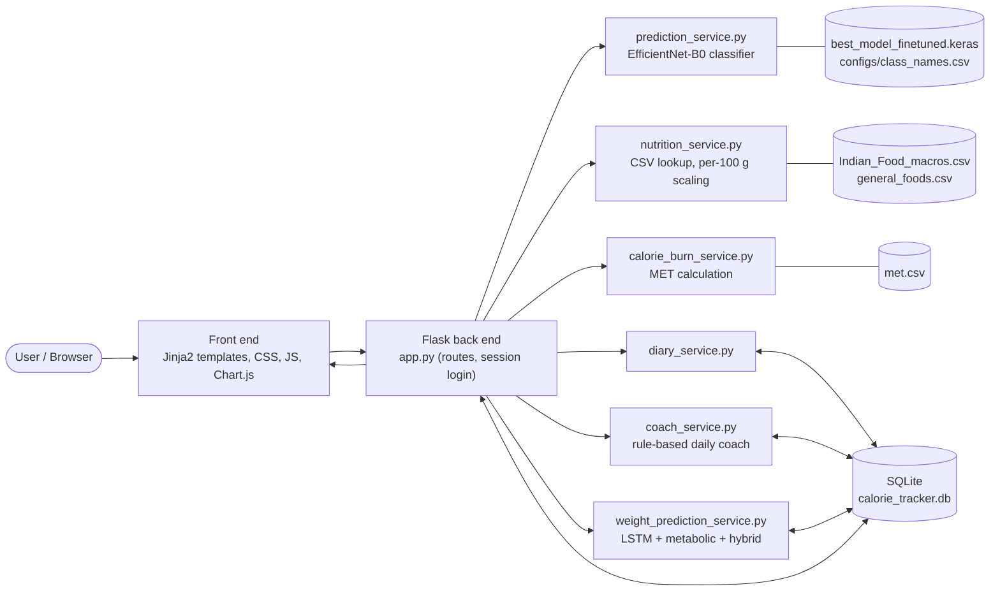
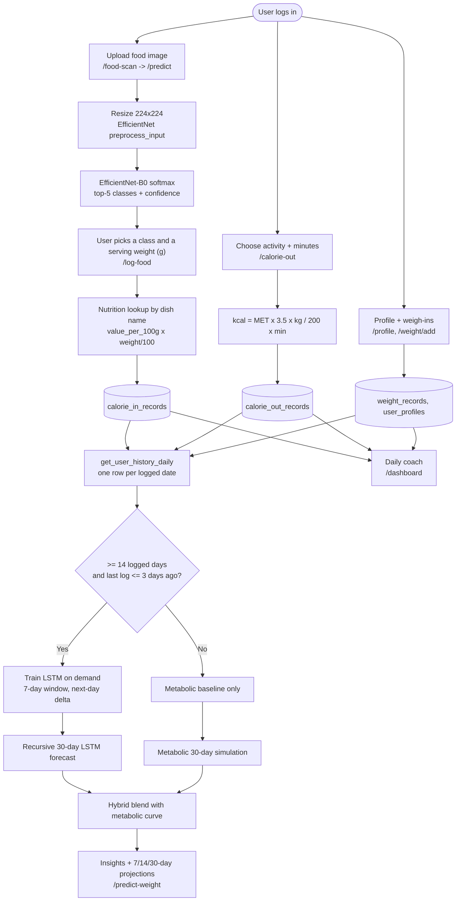
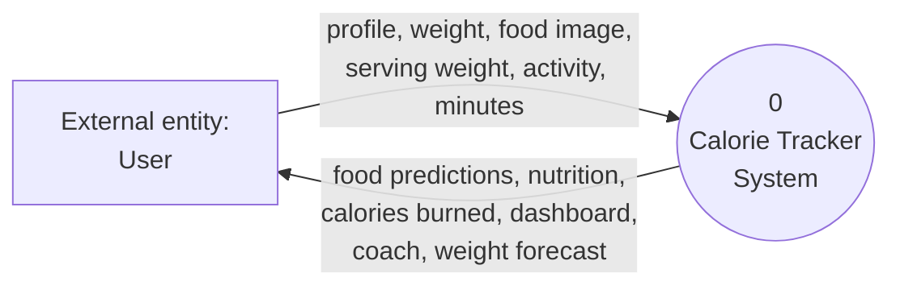
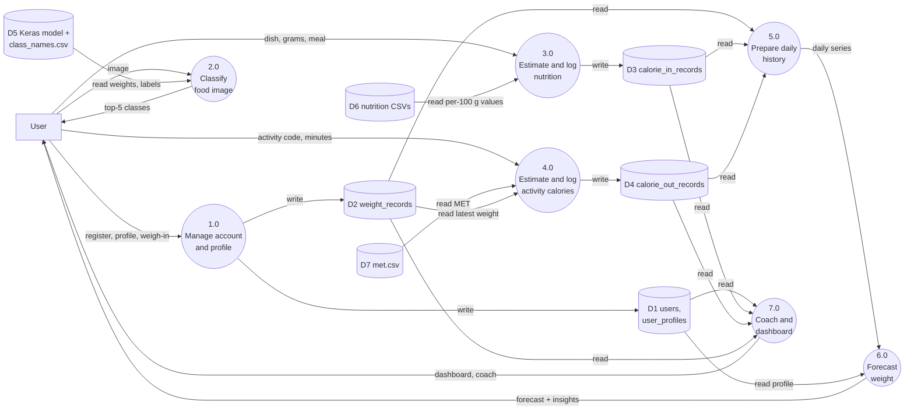
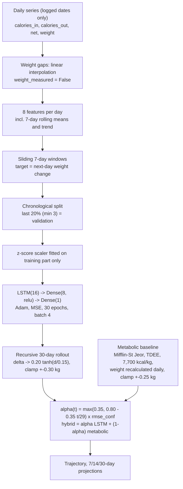

# Calorie Tracker: AI-Based Food Recognition, Calorie Estimation, and Hybrid Weight Forecasting System

*Project documentation, system architecture, and viva notes*

> **Source of truth.** Every technical statement below was checked against the repository at commit `0d3a60c` (files: `app.py`, `database.py`, `config.py`, `services/*.py`, `templates/*.html`, `data/*.csv`, `outputs/checkpoints/best_model_finetuned.keras`). Where the code does not settle a question, it is marked **[not verifiable from repo]**. No accuracy figures, datasets, or literature results are invented; the repository contains **no training code, no classifier evaluation, no forecasting evaluation, and no automated tests**.

> **Note on the supplied architecture image.** Only the prompt text file reached this session; the diagram image itself was not received. The diagrams in Section 8 were therefore drawn directly from the code. If you send the image, it can be compared against them and any discrepancies listed.

---

## Abbreviations

| Term | Meaning |
|---|---|
| BMR | Basal Metabolic Rate: energy the body uses at rest |
| TDEE | Total Daily Energy Expenditure: BMR scaled by an activity factor |
| MET | Metabolic Equivalent of Task: activity intensity as a multiple of resting energy use |
| LSTM | Long Short-Term Memory: a neural network for sequences |
| DFD | Data Flow Diagram |
| CNN | Convolutional Neural Network |

---

## Section 1: Introduction

**Calorie Tracker** is a Flask web application that lets a registered user log what they eat, log how they exercise, record their body weight, and see a forecast of their weight over the next 30 days.

Tracking intake, expenditure, and weight together is useful because weight change is driven largely by energy balance (calories in minus calories out), and the three quantities are normally recorded in separate places. The application stores them per user in one SQLite database.

**Food logging.** Typing a dish name and estimating nutrition is tedious. The user can instead upload a photo; an EfficientNet-B0 image classifier proposes the five most likely dishes out of 80 classes. The classifier only names the dish. Calories and nutrients then come from a separate step: a lookup in a nutrition CSV, scaled by the serving weight (in grams) that the user chooses.

**Forecasting.** Once enough history exists (at least 14 logged days), an LSTM is trained on that user's own records. Alongside it, a physics-style *metabolic baseline* simulates weight from the energy balance. The two forecasts are blended by a fixed, hand-designed formula in which the LSTM's share decreases with the forecast horizon. Using both avoids relying on a single method: the LSTM can pick up personal habit patterns, while the metabolic model needs no history beyond a profile and a recent average.

**System overview.** User → web pages → Flask routes → services (classifier, nutrition lookup, MET calculator, diary, coach, forecaster) → SQLite → dashboard and forecast pages.

---

## Section 2: Problem Statement

**Problems that motivate the project**

1. Manual food logging is slow.
2. Users find it hard to estimate nutrition for a dish.
3. Food, activity, and weight records are often kept in separate tools.
4. Simple calculators ignore an individual's own trend.
5. A forecast built on a single method has weaknesses specific to that method.

**Academic problem statement.** *To design and implement an integrated web application that (a) reduces the effort of food logging through image-based dish recognition coupled to a nutrition lookup, (b) records energy intake, activity expenditure, and body weight in one per-user store, and (c) produces a 30-day weight forecast by combining a personalised LSTM with a metabolic-energy-balance baseline.*

**What the implementation addresses, and what remains open**

| Problem | Addressed? | Remaining limitation |
|---|---|---|
| 1. Slow logging | Partly. Image classification proposes a dish; the user still confirms it and **chooses the grams** | Portion size is not estimated from the image |
| 2. Hard nutrition estimation | Partly. Per-100 g CSV values scaled by grams | Only 80 dishes plus 30 general foods; custom entry is manual |
| 3. Scattered records | Yes, for the application's own data | No import from wearables or other apps |
| 4. Ignoring personal trend | Partly, via the LSTM once ≥ 14 days exist | Small per-user data; no measured accuracy |
| 5. Single-method weakness | Addressed by design (two methods blended) | Superiority of the blend is **not demonstrated** |

---

## Section 3: Existing System

Conventional approaches and how this project differs. (No specific commercial application is evaluated here; the rows describe general approaches.)

| Existing approach | Limitation | How this project differs |
|---|---|---|
| Manual food entry | Time-consuming, depends on user searching a database | Photo upload gives top-5 dish candidates (`predict_food`) |
| Static nutrition databases | Values only useful if the user also supplies the quantity | Same dependency remains, but values are scaled automatically by grams (`get_nutrition`) |
| Basic calorie/activity calculators | One-off numbers, not tied to a user's history | MET result is saved to `calorie_out_records` and feeds the daily energy balance |
| Weight tracking by averages or simple formulas | Ignores energy intake and personal patterns | Forecast uses logged intake, burn, and weight history |
| Apps that separate food logging from forecasting | The two functions do not inform each other | Single database; forecast reads the same diary tables |

---

## Section 4: Proposed System

The workflow, with the six concerns kept separate as requested:

| Concern | What happens | Where in code |
|---|---|---|
| 1. Food recognition | Image → resize → EfficientNet-B0 → top-5 dish names with confidence | `services/prediction_service.py` |
| 2. Nutritional estimation | Dish name + grams → nutrients from CSV | `services/nutrition_service.py`, `services/diary_service.py` |
| 3. Activity calories | Activity code + minutes + body weight → kcal burned | `services/calorie_burn_service.py` |
| 4. Data storage | Six SQLite tables | `database.py` |
| 5. Weight forecasting | Daily history → LSTM, metabolic baseline, hybrid | `services/weight_prediction_service.py` |
| 6. Recommendations | Rule-based daily calorie coach and forecast insights | `services/coach_service.py`, `predict_weight_trajectory` |

**End-to-end flow**

1. The user registers or logs in (session cookie; passwords hashed with Werkzeug), then sets a **profile** (age, gender, height, goal, activity level) and records **body weight**.
2. **Food image upload** (`/food-scan` → `/predict`): the file is checked for extension (jpg, jpeg, png, bmp, gif, webp) and a 10 MB size cap, saved to `uploads/` with a timestamp prefix, and classified.
3. **Preprocessing**: `tf.image.decode_image` (3 channels) → resize to 224×224 → `efficientnet.preprocess_input`.
4. **Classification**: EfficientNet-B0 returns a softmax over 80 classes; the top 5 with confidence percentages are shown.
5. The user picks a dish and a **serving weight** (preset values 50–500 g or custom) on `/log-food`. Users can alternatively search the nutrition database by name, pick from 30 general-food presets, or enter custom per-100 g nutrition.
6. **Nutrition**: each nutrient = per-100 g value × grams / 100. Eleven nutrients are stored.
7. **Activity**: the user selects an activity from `data/met.csv` (1,125 rows) and minutes; calories are computed and saved.
8. **Storage**: records go to `calorie_in_records`, `calorie_out_records`, `weight_records`.
9. **History preparation**: `get_user_history_daily` produces one row per *date that has any record*, with total intake, total burn, and the latest weight of that day.
10. **Forecast** (`/predict-weight`): see Section 6 for the gating conditions and models.
11. **Dashboard** (`/dashboard`): today's intake, burn, net calories, weight statistics, and the rule-based Smart Calorie Coach.

---

## Section 5: Research Gap

Each gap is labelled by type. **No literature review was performed for this report**, so no gap is claimed to be absent from published work; literature-related claims are marked for verification.

| Gap | Type | Status |
|---|---|---|
| Food-image recognition is rarely connected to a user's own weight history | General motivation | **Requires verification** against the literature before it is stated as a research gap |
| Dependence on manual entry | General motivation | Partly reduced here (photo → dish suggestion), but grams are still manual |
| Calorie-balance arithmetic is separate from learned time-series models | Engineering gap in typical apps | This project places both in one application |
| Hybrid (learned + mechanistic) forecasting inside one integrated app | Engineering gap | Implemented with a fixed blending rule; **no evidence it outperforms either part** |
| Short- and long-horizon forecasts should be evaluated separately | Evaluation concern | Not yet done in this repository (see Section 10) |

**Specific gap this project attempts to address:** an *engineering integration* gap, namely a single application in which image-assisted food logging, MET-based activity logging, per-user persistence, and a horizon-aware blend of a personalised LSTM and an energy-balance model all share one database. Whether this blend improves forecast accuracy is left as an empirical question.

---

## Section 6: Models and Algorithms

### A. Food classification

- **Architecture (read from the saved model's `config.json`):** Input → `efficientnetb0` backbone (238 sub-layers) → `GlobalAveragePooling2D` → `Dropout(0.3)` → `Dense(80, softmax)`.
- **Classes:** 80, listed in `configs/class_names.csv`. All 80 names exist in `data/Indian_Food_macros.csv` (checked).
- **Pipeline:** image file → decode (3 channels) → resize 224×224 → `preprocess_input` → `model.predict` → `argsort` → top-5 with `confidence = probability × 100`.
- **Pretrained / fine-tuned / scratch?** The checkpoint is named `best_model_finetuned.keras` (saved with Keras 3.12.0, dated 2026-07-21 in its metadata), and in the saved configuration only 23 of the backbone's 238 sub-layers are marked trainable. This is consistent with transfer learning with partial fine-tuning, but **the training script, dataset, and pretrained-weight source are not in the repository**, so the training procedure and any accuracy figures are **[not verifiable from repo]**.
- **Link to nutrition:** the predicted class string is used as the dish name for the CSV lookup. The classifier output is a *label only*; the app does not compute calories from the image.
- **Limitation:** a class label does not give portion size or exact calorie content. Two photos of the same dish can represent very different amounts. Only the 80 trained dishes can be recognised.

### B. Nutritional estimation

`nutrition_service.get_nutrition(dish_name, weight)`:

```
nutrient_value = value_per_100g × (weight_g / 100)        (rounded to 2 decimals)
```

- `value_per_100g`: the dish's CSV row (`Indian_Food_macros.csv`, 80 dishes; if absent, `general_foods.csv`, 30 foods). Matching is exact, case-insensitive.
- `weight_g`: serving weight chosen by the user.
- Eleven nutrients are scaled: calories, protein, carbohydrates, fats, free sugar, fibre, sodium, calcium, iron, vitamin C, folate.
- *Illustrative example:* `aloo_shimla_mirch` is 92 kcal/100 g in the CSV; a 150 g serving gives 92 × 150 / 100 = **138 kcal**.
- **Limitations:** one fixed value per dish (no recipe or regional variation); the CSV's provenance is **[not verifiable from repo]**; custom-food values are whatever the user types. Unmatched names return `None`. Note that the general-foods *presets* list omits several micronutrients (sodium, calcium, iron, vitamin C, folate are set to 0.0 in `get_general_foods_presets`), although `get_nutrition` does read them from the CSV when a general food is logged by name.

### C. Activity calorie estimation

`calorie_burn_service.calculate_calories_burned`:

```
calories_burned = MET × 3.5 × weight_kg / 200 × duration_minutes
```

- **MET**: the activity's energy cost as a multiple of resting metabolism (1 MET ≈ 3.5 mL O₂/kg/min). Values come from `data/met.csv`, whose columns are `Actvitiy` (sic), `Code`, `MET`, `Description`.
- `weight_kg`: body weight, defaulting to the user's latest recorded weight.
- *Illustrative example:* MET 4.3, 65 kg, 30 min → 4.3 × 3.5 × 65 / 200 × 30 ≈ **146.7 kcal**.
- **Limitations:** MET values are population averages; the formula ignores fitness, body composition, and actual intensity; it gives *gross* calories (including the resting component during the activity).

### D. Metabolic baseline

Everything below exists in `weight_prediction_service.py`:

| Element | Implemented? | Detail |
|---|---|---|
| Mifflin–St Jeor BMR | Yes | `10·kg + 6.25·cm − 5·age + 5` (male), `− 161` (female), `− 78` (other; the average) |
| Activity multipliers | Yes | sedentary 1.2, lightly active 1.375, moderately active 1.55, very active 1.725, super active 1.9 (default 1.55) |
| Exercise accounting | Yes, with a double-counting guard | If exercise is logged: `burn = max(TDEE_profile, BMR×1.2 + logged_exercise)`; otherwise `TDEE_profile` |
| Daily energy balance | Yes | `avg_calories_in − daily_burn`, where `avg_calories_in` is the mean of the last 14 logged days (replaced by TDEE if it is ≤ 500 kcal) |
| kcal per kg | Yes | 7,700 kcal per kg (Wishnofsky rule of thumb) |
| Weight-dependent recalculation | Yes | BMR and burn are recomputed from the simulated weight each day, producing a flattening curve |
| Constraints | Yes | daily change clamped to ±0.25 kg; weight bounded to 25–350 kg |

**Role:** it is the always-available forecast. It needs only a profile and a latest weight, and it is the fallback when the LSTM is unavailable. It assumes constant average intake and exercise over the horizon.

**Limitations:** the 7,700 kcal/kg rule ignores water, glycogen, lean-mass changes and adaptive thermogenesis (the code's own comments say this); BMR equations are population averages.

### E. LSTM weight forecasting

*In plain terms:* the model looks at the last 7 days of a user's habits and weight, and guesses how much their weight will change tomorrow. To forecast 30 days it repeats this, feeding each guess back in.

| Aspect | Implementation |
|---|---|
| Time series | Rows from `get_user_history_daily` (ascending). **Only dates that have at least one record are included; missing calendar dates are not filled**, so a "7-day window" is seven *logged* days |
| Missing weights | Linearly interpolated between weigh-ins (by row position); leading/trailing gaps filled with the nearest measurement; a `weight_measured` flag is kept |
| Features (8) | `calories_in`, `calories_out`, `net_calories`, `weight_kg`, `weight_7d_avg`, `weight_7d_trend`, `cal_in_7d_avg`, `cal_net_7d_avg` |
| Window | 7 timesteps × 8 features |
| Network | `LSTM(16, tanh)` → `Dense(8, relu)` → `Dense(1)`; Adam; MSE loss; 30 epochs; batch size 4; fixed seed 42 |
| Target | **Next-day weight change** (kg), not absolute weight |
| Sequences | `n − 7` windows for `n` logged days (e.g. 180 days → 173) |
| Split | Chronological: validation = last `max(3, 20%)` sequences; no shuffling |
| Scaling | z-score (mean/std) fitted on the training portion only |
| Sample weights | 1.0 for real weigh-ins, 0.5 where the target weight was interpolated |
| Recursive forecast | Start from the latest 7 days. Predict delta → damp: `0.20·tanh(delta/0.15)` → clamp ±0.30 kg → add to running weight → append a synthetic day and repeat for 30 steps |
| Future inputs | Not model-predicted: future calories in/out are **day-of-week averages of the user's whole history** |
| Minimum history | ≥ 14 logged days (`n ≥ 2 × window`) |
| Stale or insufficient history | If < 14 logged days, or last log > 3 days ago, or training raises an error, the metabolic baseline is used alone |
| Retraining | On every request to `/predict-weight`; the model is not persisted |

**Error accumulation.** Each step's output becomes the next step's input, so an error at day 3 is carried into day 4 and beyond. The damping and clamping limit runaway drift but do not remove the accumulation.

**Validation metrics vs. real forecast skill.** The reported `weight_mae`/`weight_rmse` are computed **one day ahead**: the model's damped delta is added to the *actual* previous-day weight. They say nothing about 7-, 14- or 30-day accuracy. They are also computed on only the last ~20% of one user's data, with some targets being interpolated weights.

### F. Hybrid weight prediction

Implemented in `predict_weight_trajectory`:

```
rmse_conf = max(0.4, min(1.0, 1 / max(1, val_rmse)))
alpha(t)  = max(0.35, 0.80 − 0.35 · t/(H−1)) × rmse_conf       t = 0 … H−1,  H = 30
hybrid(t) = alpha(t) · lstm(t) + (1 − alpha(t)) · metabolic(t)
```

- **alpha** is the LSTM's share of the blend. Near 1 means trust the LSTM; near 0 means trust the metabolic model.
- **Horizon:** alpha falls linearly from 0.80 on day 1 to 0.45 on day 30 (the 0.35 floor is never reached before the confidence factor is applied).
- **Validation adjustment:** if one-day validation RMSE ≤ 1 kg, `rmse_conf = 1`; larger RMSE scales alpha down to as low as 0.4× (so final alpha can reach about 0.18).
- **Nature of the method:** fixed and hand-designed, **not learned and not empirically optimised**. The decline of the LSTM share is a programmed design choice, not a property of LSTMs.
- **Discrepancy noted:** a comment in the code says the LSTM covers "days 1–7" and the metabolic model "days 8–30"; the code actually blends smoothly over all 30 days.
- **No evidence of superiority.** No experiment in the repository compares hybrid, LSTM-only, and metabolic-only forecasts.

### G. Coaching and recommendations

Both recommendation sources are **explicit rules and thresholds, not a generative model and not a model output**.

- *Daily calorie coach* (`coach_service.get_daily_calorie_coach`): target = TDEE − 500 (floor 1,200) for loss, TDEE + 400 for gain, TDEE for maintenance. It compares `net intake = intake − logged exercise` with the target, and if over budget it inverts the MET formula to give minutes needed for six preset activities.
- *Forecast insights* (`predict_weight_trajectory`): thresholds on `daily_energy_balance` (for example, a deficit larger than 200 kcal/day is labelled "On Track" for loss).
- **Observed inconsistency:** the coach target is based on the full activity-multiplier TDEE *and then* subtracts logged exercise, so exercise can be counted twice; the forecasting code explicitly avoids this (`calculate_daily_burn`), but the coach does not use that function.

### H. Model comparison table

| Component | Purpose | Inputs | Outputs | Main limitation |
|---|---|---|---|---|
| EfficientNet-B0 classifier | Name the dish | 224×224 RGB image | Top-5 of 80 classes + confidence | Label only; no portion size; 80 classes; accuracy unreported |
| Nutrition lookup | Nutrients for a serving | Dish name, grams | 11 nutrient values | One value per dish; depends on CSV quality |
| MET formula | Exercise calories | MET, kg, minutes | kcal burned | Population-average MET |
| Metabolic baseline | Energy-balance forecast | Profile, latest weight, 14-day averages | 30 daily weights | 7,700 kcal/kg rule; constant intake assumed |
| LSTM | Personal habit-based forecast | 7×8 window | Next-day Δweight → 30-day path | Small data; error accumulates; validation is one-day only |
| Hybrid blend | Combine the two forecasts | LSTM path, metabolic path, val RMSE | 30 daily weights | Fixed heuristic weights; unproven benefit |
| Coach rules | Budget and advice | Profile, today's records | Targets, messages, burn-off minutes | Thresholds are fixed; possible exercise double-count |

---

## Section 7: Front End and Back End

### Front end

- **Templates** (Jinja2, `templates/`): `base.html` (layout, navigation, Google tag), `home`, `login`, `register`, `profile`, `food_scan`, `prediction_result`, `foods`, `log_food`, `diary`, `history`, `calorie_out`, `dashboard`, `predict_weight`.
- **Styling:** one stylesheet, `static/css/style.css`.
- **JavaScript:** inline scripts only. `calorie_out.html` calls `/api/activities/<category>` and `/api/calculate-calories` with `fetch`; `log_food.html` has form logic; `predict_weight.html` draws the 30-day trajectory with **Chart.js** loaded from a CDN.
- **Pages and routes:**

| Route | Purpose | Login needed |
|---|---|---|
| `/`, `/register`, `/login`, `/logout` | Home and account | no (except logout flow) |
| `/profile`, `/weight`, `/weight/add`, `/weight/delete/<id>` | Profile and weight | yes |
| `/food-scan`, `/predict` | Upload and classify | yes |
| `/log-food`, `/diary`, `/diary/<date>`, `/history`, `/export` (CSV), `/food/delete/<id>` | Food logging and review | yes |
| `/foods`, `/api/foods`, `/api/general-foods`, `/api/nutrition` | Food search and nutrition API | no |
| `/calorie-out`, `/api/activities/<category>`, `/api/search-activities`, `/api/calculate-calories`, `/calorie-out/delete/<id>` | Activity logging | mixed |
| `/dashboard`, `/predict-weight` | Daily summary and forecast | yes |


### Back end

- **Framework:** Flask (`app.py`, ~1,376 lines), served with gunicorn (`Procfile`; one worker, four threads), Python 3.11.9.
- **Session/authentication:** Flask `session` cookie; `login_required` decorator; passwords stored with Werkzeug `generate_password_hash`.
- **Service modules:** `prediction_service` (loads the Keras model once at start-up), `nutrition_service` (loads CSVs once), `calorie_burn_service` (loads MET CSV once), `diary_service`, `coach_service`, `weight_prediction_service`.
- **Configuration:** `config.py` (paths overridable by environment variables, `IMG_SIZE=(224,224)`, `TOP_K=5`, 10 MB upload cap).
- **Dependencies:** Flask, tensorflow, numpy, pandas, Pillow, scikit-learn, Werkzeug, gunicorn. (`scikit-learn` is listed in `requirements.txt` but is not imported anywhere in the code; scaling is done with NumPy.)
- **Utility:** `seed_test_data.py` generates a 180-day development dataset for one test account.

### Database (SQLite, `calorie_tracker.db`)

| Table | Purpose | Key fields |
|---|---|---|
| `users` | Accounts | `id`, `username`, `email` (unique), `password_hash` |
| `user_profiles` | One profile per user (`user_id` unique) | `age`, `gender`, `height_cm`, `goal`, `activity_level` |
| `weight_records` | Weigh-ins | `user_id`, `weight_kg`, `recorded_date` |
| `calorie_in_records` | Food diary | `user_id`, `dish_name`, `quantity` (g), `meal_type`, 11 nutrient columns, `recorded_date`, `recorded_time` |
| `calorie_out_records` | Activity log | `user_id`, `activity`, `met`, `weight_kg`, `duration_minutes`, `calories_burned`, `recorded_date` |
| `exercise_records` | Legacy table, no `user_id`; nothing in the code reads it (verified by search) | — |

**Relationships:** `user_profiles`, `weight_records`, `calorie_in_records`, `calorie_out_records` each reference `users(id)` with `ON DELETE CASCADE`. Indexes exist on `(user_id, recorded_date)` for the three record tables. (`get_connection` runs `PRAGMA foreign_keys = ON`, so the cascade is enforced.)

**Architecture summary**

```
User → Browser (templates, Chart.js) → Flask routes (session auth)
      → services: classifier | nutrition lookup | MET | diary | coach | forecaster
      → SQLite (read/write)  → rendered page or JSON → Browser
```

---

## Section 8: Data Flow Diagram (DFD) and System Architecture

Editable Mermaid sources are in `docs/diagrams/*.mmd`. Paste them into any Mermaid renderer (for example mermaid.live) to export SVG or PNG. The diagrams are **drawn from the code**, not copied from the supplied image (not received).

### Diagram 1: High-level system architecture (a system architecture diagram, not a DFD)



*Caption:* The browser talks to Flask; Flask delegates to six service modules; three of them read static model or CSV files, and four read or write SQLite.

*Viva paragraph:* "The user works in the browser. Every request goes to a Flask route in `app.py`, which calls a service module. The classifier loads a Keras EfficientNet-B0 model once at start-up. Nutrition and MET values come from CSV files. All personal records live in one SQLite database. The forecasting module reads the database and returns a 30-day forecast that the template draws with Chart.js."

### Diagram 2: Application workflow (a system flowchart)



*Caption:* Three input flows (weight, food, activity) converge on one daily history that gates the forecast. Arrows into a cylinder are writes; arrows out of a cylinder are reads.

*Differences from the prompt's suggested flow:* (1) the user, not the classifier, selects the final dish and grams; (2) the metabolic model always runs, and the LSTM is added only when conditions are met; (3) when the LSTM is unavailable the displayed forecast is the metabolic baseline, not a hybrid.

*Viva paragraph:* "Food, activity and weight each have their own input path and table. A single query merges them into one row per logged date. If there are at least 14 logged days and the user has logged within the last three days, the LSTM is trained on the spot and blended with the metabolic simulation; otherwise only the metabolic simulation is shown."

### Diagram 3: DFD Level 0 (context diagram)



### Diagram 4: DFD Level 1



*Caption:* Seven processes, four database stores (D1–D4), three static file stores (D5–D7). Process 5.0 is a logical grouping of the SQL query `get_user_history_daily` and series preparation.

*Notes on DFD conventions:* In strict DFDs, data stores are not connected directly to external entities, which is respected above. The user's selection of a dish after process 2.0 is shown as the user sending "dish, grams, meal" to 3.0. The uploaded file is also saved to `uploads/` and never deleted by the code; that folder is a further (unnumbered) store not drawn here.

*Viva paragraph:* "At Level 0 the whole app is one process with the user as the only external entity. At Level 1 it splits into seven processes. Static files are read-only stores; the four database tables are written by the logging processes and read by the history, forecast and dashboard processes."

### Diagram 5: Forecasting pipeline



---

## Section 9: System Workflow / Algorithm

1. The user opens the app; unauthenticated users see only home, login, register, and public food/activity lookups.
2. After login the profile and weight history are loaded; a latest weight and a profile are prerequisites for the coach, activity auto-fill, and forecast.
3. The user logs food by (a) image → top-5 → pick, (b) search by name, (c) general-food preset, or (d) custom per-100 g values.
4. The chosen dish name is matched (exact, case-insensitive) to a nutrition CSV row.
5. Nutrients are scaled by `grams / 100`.
6. The user logs activities; calories = `MET × 3.5 × kg / 200 × minutes`.
7. Records are written to SQLite; the dashboard and diary read them back.
8. For forecasting, one row per logged date is built; missing weights are interpolated.
9. The metabolic baseline is always computed. The LSTM is trained only if ≥ 14 logged days exist and the last log is ≤ 3 days old.
10. If the LSTM ran, the hybrid curve is displayed; otherwise the metabolic curve is displayed (with an explanatory status message).
11. Insights (rule-based) and 7/14/30-day projections are assembled.
12. `predict_weight.html` renders the numbers and a Chart.js trajectory.

**Pseudocode (as implemented, simplified)**

```
series  = interpolate_missing_weights(history_by_logged_date(user))
metab   = simulate_metabolic(weight, profile, mean_intake_14d, mean_burn_14d, 30)
if len(series) >= 14 and days_since_last_log <= 3:
    X, y   = windows(features(series), size=7), next_day_weight_delta
    split  = chronological(X, y, val=max(3, 20%))
    scaler = fit(split.train)
    model  = LSTM16 → Dense8 → Dense1 ; fit(30 epochs, batch 4, sample_weights)
    val_rmse = one_day_weight_rmse(model, split.val)
    lstm = []
    for step in 1..30:
        d = model(scaled_last_7_days)
        d = clamp(0.20 * tanh(d / 0.15), -0.30, +0.30)
        w = w + d
        append synthetic day (day-of-week average intake/burn, weight = w)
    conf = clamp(1 / max(1, val_rmse), 0.4, 1.0)
    hybrid[t] = alpha(t)*lstm[t] + (1 - alpha(t))*metab[t],  alpha(t)=max(0.35, 0.80 - 0.35*t/29)*conf
else:
    display metab
```

---

## Section 10: Testing and Evaluation

**What exists in the repository:** `seed_test_data.py`, a data generator that creates a 180-day synthetic history for one development account and runs checks such as the expected number of training sequences (173) and an end-to-end LSTM call. It is a seeding and sanity-check script, **not an accuracy evaluation**, and its data are synthetic. There is no `tests/` directory and no stored metrics.

**Proposed evaluation plan (not yet done)**

| Area | Proposed method | Metrics |
|---|---|---|
| Food classification | Held-out test split of the dish dataset (dataset **[not verifiable from repo]**); also a small set of real user photos | Top-1/Top-5 accuracy, per-class precision, recall, F1, confusion matrix |
| Nutritional-estimation error | Compare lookup values with weighed portions and reference tables for a sample of dishes | MAE and % error in kcal |
| Activity estimation | Compare with a wearable or lab reference on a small sample | MAE, bias; discuss MET limits |
| LSTM validation | Already printed per request (one-day-ahead) | Delta MAE/RMSE, weight MAE/RMSE; report with the validation window size |
| Multi-day forecast | Rolling-origin evaluation on real users: forecast from origin *t* and compare with actual weights at *t+7, t+14, t+30* | MAE/RMSE per horizon |
| Hybrid vs components | Same rolling-origin protocol for LSTM-only, metabolic-only, hybrid; plus a naive "last weight" baseline | MAE/RMSE per horizon, paired comparison |
| Software testing | Unit tests for formulas, route tests with Flask's test client, upload edge cases | Pass/fail |

**Why one-day validation is not enough.** The code's validation adds the predicted daily change to the *true* previous weight each time, so errors never compound. A 30-day forecast compounds its own errors and relies on assumed future intake. A good one-day score can coexist with a poor 7-, 14- or 30-day forecast, so horizons must be evaluated separately.

---

## Section 11: Advantages, Limitations, and Future Improvements

**Advantages (supported by the code)**

- One application and one database for food, activity, and weight.
- Image-assisted dish suggestion with confidence for the top five, and several fallback logging routes.
- Transparent formulas (per-100 g scaling, MET, Mifflin–St Jeor).
- Forecast degrades gracefully to the metabolic baseline when history is short or stale.
- Safeguards in the forecaster: chronological split, scaler fitted only on training data, interpolation flags with lower sample weights, exercise double-count guard, damping and clamping.

**Limitations**

- Classification: 80 classes only; misclassification possible; accuracy not reported; no confidence threshold for rejection.
- Portion size is user-chosen; no estimate from the image.
- Nutrition database coverage is small (80 + 30 entries); one value per dish.
- MET calories are averages and gross.
- The daily series skips dates with no records and interpolates weights, so "7 days" can span more than 7 calendar days.
- LSTM trains on very small data (about 14–365 points), is retrained per request, and has only one-day validation.
- Recursive forecasting accumulates error; future intake is assumed from past day-of-week averages.
- Metabolic assumptions (7,700 kcal/kg, constant intake) are simplifications.
- The hybrid weights are heuristic and unvalidated.
- The coach may double-count exercise (target uses the full TDEE multiplier, then subtracts logged exercise).
- **Security and privacy:** `SECRET_KEY` falls back to a hard-coded default if the environment variable is unset; `app.run(debug=True)` in the main block is unsuitable for production; uploaded images remain on disk; health data are stored unencrypted in SQLite; `/api/calculate-calories` is a POST that returns JSON and relies on session login only (no CSRF protection was observed). The database file `calorie_tracker.db` is committed to the repository, which may contain account data and should be checked before the repo is made public.
- The medical accuracy of any forecast is not claimed; this is a lifestyle-tracking tool, not a clinical one.

**Future improvements (not implemented)**

- Portion-size estimation or a reference object in the photo; a "not sure" threshold for low-confidence predictions.
- Larger, regionally varied nutrition database with recipe-level data.
- Rolling-origin evaluation with a naive baseline; learn or tune the blend weights from that evidence.
- Fill missing calendar dates explicitly; model persistence per user.
- Unit and integration tests; environment-only secrets; CSRF protection; image cleanup.
- Use the same double-count-safe burn calculation in the coach.

---

## Section 12: Conclusion

Calorie Tracker integrates computer vision (EfficientNet-B0 dish recognition), a nutrition lookup scaled by serving weight, MET-based activity calories, SQLite persistence, and a 30-day weight forecast that blends a per-user LSTM with a metabolic energy-balance model. The intended benefit is a lower-effort, more connected way to log food, activity, and weight. What the repository does not yet contain is empirical evidence: no classifier accuracy, no nutrition-error study, and no multi-horizon forecast comparison. The claim that the hybrid is better than either component should therefore be treated as a design hypothesis until the evaluation plan in Section 10 has been carried out.

---

# Appendix A: Presentation outline (10 slides)

1. **Title and goal:** what the app does in one sentence.
2. **Problem:** slow logging, scattered records, single-method forecasts.
3. **Existing approaches vs. this project:** the Section 3 table, condensed.
4. **System architecture:** Diagram 1.
5. **Food pipeline:** image → EfficientNet-B0 → top-5 → user picks grams → CSV → kcal. Stress "label, not calories".
6. **Activity and metabolic maths:** MET formula; Mifflin–St Jeor; 7,700 kcal/kg.
7. **Forecasting:** Diagram 5; LSTM details; hybrid formula and alpha plot.
8. **Data and DFD:** DB tables; DFD Level 1.
9. **Evaluation status and limitations:** what is measured (nothing yet), the evaluation plan, security notes.
10. **Conclusion and future work.**

# Appendix B: Short viva answers

- **Overall architecture:** "A Flask app with six service modules and one SQLite database. The classifier and CSVs are loaded at start-up; the forecaster reads the database on each request."
- **EfficientNet-B0:** "A CNN backbone with global pooling, 30% dropout and an 80-way softmax. It outputs a dish label only; calories come from a CSV scaled by the grams the user selects."
- **Was it trained from scratch?** "The file is called *finetuned* and most backbone layers are frozen in the saved config, which suggests transfer learning, but the training code is not in the repository, so I cannot state the training details."
- **MET formula:** "kcal = MET × 3.5 × kg / 200 × minutes. MET is the activity's intensity relative to rest. It is an average and does not account for individual fitness."
- **Metabolic model:** "Mifflin–St Jeor BMR, an activity multiplier, daily energy balance, 7,700 kcal per kg, BMR recalculated as weight changes, daily change capped at 0.25 kg."
- **LSTM:** "Seven days of eight features predict tomorrow's weight *change*. Training is chronological, scaling uses only training data, and forecasts are recursive. Its validation error is one-day-ahead only."
- **Hybrid:** "A fixed weighted average. The LSTM weight starts at 0.80 and falls to 0.45 over 30 days, scaled down if validation error is high. I chose this heuristic; I have not shown it beats either component."
- **Why is validation not proof of 30-day accuracy?** "Because each validation prediction starts from the true previous weight, so errors never accumulate the way they do in a 30-day rollout."
- **Biggest limitation?** "No measured accuracy for the classifier or the forecasts yet, and portion size is user-supplied."
